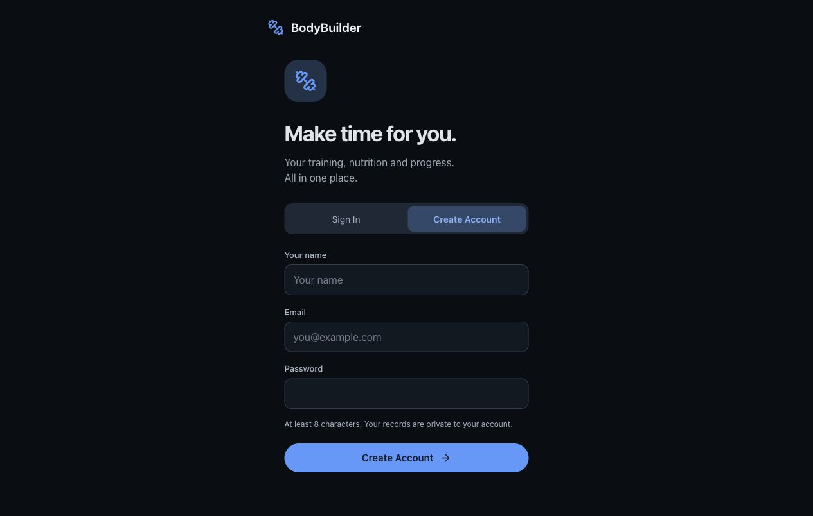
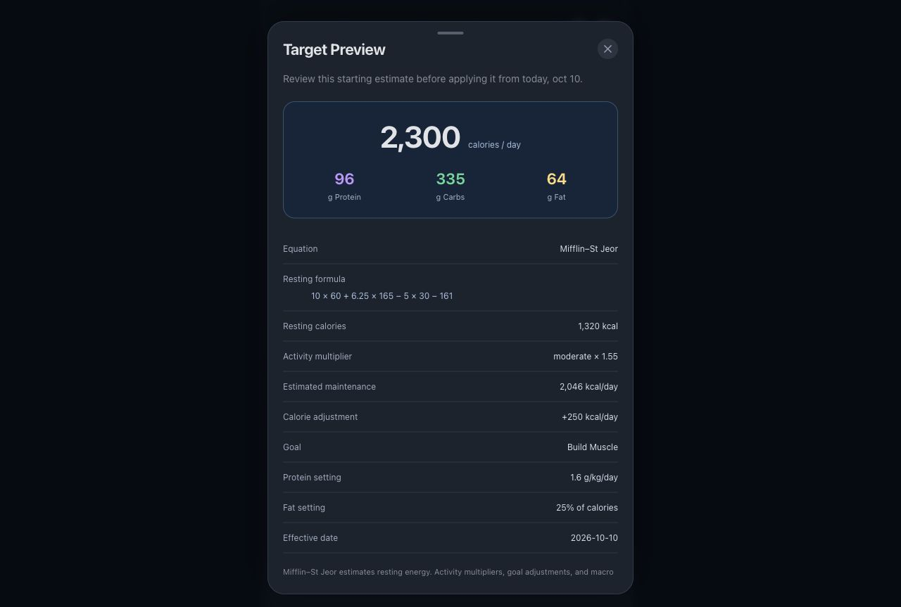

# BodyBuilder live implementation verification

Completed locally on 9–10 October 2026, Asia/Singapore. The default frontend now uses the real Go/PostgreSQL API. The sibling expense tracker was inspected as an architecture reference and was not modified.

## Delivered behavior

- Public registration/password sign-in, empty initial accounts, private records, and explicit administrator assignment.
- All five tabs: workout programs/templates/scheduling and persistent session logs; nutrition foods/copies/dated targets; dashboard; progress; personal lesson links/notes and curated readings. Daily check-ins atomically update the same dated weight record.
- A deterministic Mifflin–St Jeor calorie/macro calculator, explicit personal inputs, adjustable app settings, and an unsaved preview before Apply. The server reproduces calculation provenance; manual overrides keep the original inputs/version, and later dates retain history. Check-ins never auto-adjust targets. The same version calculates an offline preview from acknowledged inputs and queues only an explicit Apply.
- Per-account IndexedDB snapshots and a durable outbox. Stable retry IDs prevent duplicate writes; stale revisions require an explicit keep/discard decision. Refresh does not overwrite open drafts. Offline workout completion keeps the original stop time when it later reaches PostgreSQL.
- Keyless food search first uses 7,793 genuine USDA SR Legacy April 2018 records with original FDC IDs, CC0 attribution and per-100g nutrients, then Open Food Facts for unmatched queries. Own saved foods remain searchable. Quantity scaling preserves decimal nutrients and source attribution through PostgreSQL/reload. Local USDA matches survive upstream errors/rate limits; failed unmatched searches show an error and allow manual entry.
- Explicit **Ask AI** and **Estimate from Photo** actions use administrator-controlled OpenAI, Anthropic, or OpenRouter adapters. Calculation, database search, and logging never trigger AI. Keys are encrypted in PostgreSQL; limits, image validation, provider failures, and structured response parsing are tested. Photo estimates remain drafts until review/save.
- A built PWA with an offline shell and bundled exercise images. Private API responses are excluded from service-worker caches. Copying server-generated records or starting a session requires acknowledgement before dependent editing.

## Checks and results

| Check | Result | Evidence/coverage |
| --- | --- | --- |
| `go test -race ./...` with `TEST_DATABASE_URL` | Passed | Authentication/domain/service/provider tests and twelve real PostgreSQL HTTP integration cases; database tests did not skip |
| `go vet ./...` | Passed | All backend packages |
| API and administrator CLI builds | Passed | Local Go executables |
| `npm run check` | Passed | Zero Svelte/TypeScript errors or warnings |
| `npm run test:mock` | 10 passed | Fixture client persistence, validation, ownership, dates, frozen prescriptions, and draft-only estimates |
| `npm run test:nutrition` | 12 passed | Eight shared Go/TypeScript golden fixtures, required/null/unknown inputs, units, finite values, bounds, impossible allocations, dates and immutability |
| USDA importer self-tests and pinned-archive `--check` | Passed | Explicit zero/missing/invalid nutrient cases, 7,793 records, checksum verification and byte-identical reproduction |
| `npm run test:ui -- --reporter=list --max-failures=2` | 70 passed, 51.5 s | Final shared UI regression run in mobile Chromium and WebKit; all tabs, responsive widths, forms, draggable sheets, calculation/overrides, and records |
| Live development browser suite | 26 passed, 51.5 s | Real Go/PostgreSQL through the frontend; accounts, devices, conflicts, persistent records, read-only calculation, retained provenance, USDA precision/source, provider failures and offline calculation |
| Mock production PWA suite | 2 passed, 10.5 s | Offline shell/image reload and fixture record edits in both engines |
| Live production nutrition and offline suite | 12 passed, 28.1 s | All four nutrition scenarios plus disconnected-origin check-in/workout replay in both engines; original stop time, stable IDs/revisions, and no duplicated server writes |
| Production frontend builds | Passed | Both explicit mock and live builds used by their PWA checks |
| Actual in-app preview | Inspected | Refreshed real sign-in at `http://localhost:5174/`; calculator preview inspected separately with synthetic fixture inputs |
| Normal runtime and isolated cleanup | Passed | Go `/healthz` returned 200; the calculator route returned 401 without authentication directly and through port 5174; the E2E schema no longer exists |

The browser total is 110 passing checks: 70 fixture development, 26 live development, two fixture production PWA, and twelve live production nutrition/offline. Suites and builds were run sequentially because they share SvelteKit output; the last production build is live. The full live development suite was not repeated in production; the production selection covers all nutrition scenarios and the durable offline cases.

The production regression exposed a delayed dialog autofocus that could steal focus from a search field and send Enter to the resize handle. The shared sheet now preserves a control the user has already focused, and the real food-search test verifies retained keyboard focus before submitting. All four browser suites above were rerun after that fix, including dragging, scrolling, keyboard resizing, dismissal and focus restoration.

Database integration tests create and drop their own `bb_integration_*` schemas. Live browser tests used a separate `bb_e2e_*` schema, synthetic accounts/admin, and local HTTP error stubs for every upstream provider. The E2E service was stopped and its schema removed after verification. The normal development database, Go API on 8081, and frontend on 5174 remain available.

Offline checks use a per-test proxy that destroys transport sockets. An uncached probe must fail before reload/edit assertions; this disconnects both page and service-worker requests. Reconnection assertions inspect PostgreSQL-backed snapshots and acknowledged retry IDs, rather than accepting a local UI update as proof of sync.

## Limits still requiring follow-up

- USDA SR Legacy is a historical April 2018 dataset. Matching uses description-word prefixes; synonyms and inferred household portions are not implemented. Review the preparation, per-100g serving and chosen quantity. The calculator estimates energy from entered inputs and editable app policy, rather than measuring requirements.
- Valid external AI credentials/model access and actual paid responses were not tested. Provider-format tests use local HTTP stubs and fake keys. Food-provider parsing, caching, and failure behavior are tested; internet availability is not guaranteed by those checks.
- Physical iPhone/Android installation, native camera/keyboard/background behavior, and external HTTPS hosting have not been verified. Browser emulation is separate from device acceptance.
- Hero/anatomy vectors remain temporary artwork; some bundled exercise guides show related variations with explicit source names. Review captures are not approved visual golden baselines, and exact pixel parity is not claimed.
- Step tracking and progress-photo galleries remain outside this release, as requested.

## Review capture

The calculator capture uses synthetic fixture inputs in explicit mock mode and was not applied to a personal account. The same calculation is verified separately through the live Go API.

Startup, provider administration, mode selection, and reproducible commands are in the [README](../README.md). See the [API contract](api/contract.md), [browser coverage](../frontend/tests/README.md), and [PostgreSQL integration coverage](../backend/integration/README.md).
